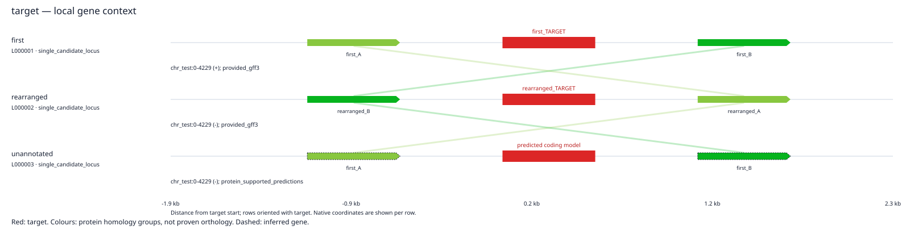
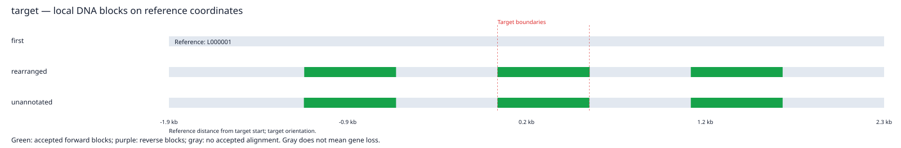

# Comparative analysis validation — v0.2.0

## Automated controls

The suite contains 40 tests. All 40 passed locally with Python 3.14.2, actual miniprot 0.18-r281, NCBI BLAST+ 2.17.0+, samtools 1.24, MAFFT 7.526 and LASTZ 1.04.60. On the Linux compute host with Python 3.10.12, 39 passed and the optional LASTZ test skipped because that executable was absent. The integration searches and alignments are not mocked.

Comparative controls include:

- Three arbitrary synthetic genomes: two annotated, one without GFF3. Query identifiers and annotation names differ across genomes.
- Reordered neighbours and whole-locus strand reversal, distinguishing conserved relative order from a changed order.
- Sequence-based neighbour matching despite different annotation names, and native-coordinate prediction of two neighbours in the unannotated genome.
- External context proteins when no input genome has annotation, and explicit unknown context when no reference evidence exists.
- Multiple query references combined into one group, preserving source candidates and isoforms while avoiding duplicate displayed loci.
- Strong incomplete targets ranked ahead of weak complete candidates, with an explicit partial-protein option and checked codon backtranslation.
- Noncoding DNA observations retained as DNA regions, including a fully lowercase-masked window with no passing alignment rather than a false zero-identity score.
- Source-search errors preserved while valid genomes continue; successful comparison does not modify source manifests.
- DNA gap/ambiguity accounting, exclusion of overlapping blocks, case preservation, and reverse-coordinate roundtrips with actual LASTZ.

## Synthetic diagrams

These are generated controls, not biological evidence for the listed project genes. The target sequence is randomly generated; two flanking genes are shared, and the middle genome has their order exchanged. The final row has no GFF3 and is annotated using reference-protein support.

The DNA comparison distinguishes accepted blocks from DNA without a passing alignment. Reference query sequences are excluded from cross-locus protein-conservation profiles.

## Whole-assembly example

The comparative stage was also applied to the saved chicken NANOG/Pou5f3 protein search across the five whole assemblies in the [original pilot](FULL_GENOME_PILOT.md). Genomic discovery was not repeated. Original source results and checksums were retained, and each extracted context window was fingerprinted.

All genomes/queries remain in the summary, including the three original NANOG nondetections. These are method-specific nondetections, not gene-loss calls. Ranked POU-family alternatives and incomplete models are visible in the report; sequence ranking does not establish individual-copy orthology. The comparative stage has both a complete-model default and an explicit `--include-partial` mode for clean fragments.

Local synteny uses provisional homology groups, not an imported gold-standard orthology set. A result based on too few anchors is marked insufficient. DNA identity is conditional on accepted aligned blocks and must be read with coverage. These checks validate operation and accounting on defined controls, not sensitivity/specificity for every gene, evolutionary distance, genome size or genetic code.

The final five-assembly example completed with zero comparison errors: **10 genome/target observations, 7 displayed candidate loci, 23 neighbouring-gene observations and 11 DNA/synteny pairs**. Eight pairs lacked enough unique synteny anchors, one retained local order/orientation, and two had an order/orientation difference. These are descriptive results for ranked candidates, not validated biological orthology or rearrangement calls.

With `--include-partial`, four clean selected coding models (three complete and one partial) entered protein/codon comparison. Three disrupted candidates stayed visible and were excluded from these alignments. An independent audit using Biopython 1.88 and samtools faidx, without importing this package, passed all **7 native-window roundtrips, 4 codon-translation checks and 11 DNA identity/coverage recalculations**. Windows preserve input letter case, and each accepted DNA block roundtrips to its input sequences. The source-file hashes recorded by this run match the v0.2.0 implementation.
